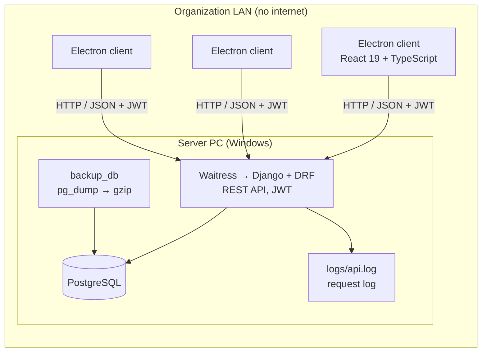
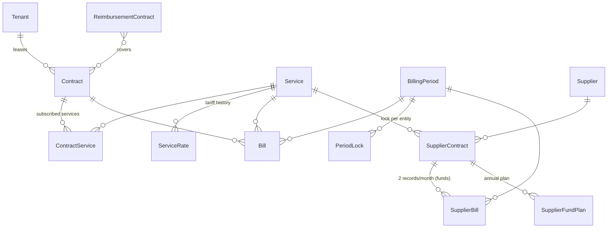

# Rent Manager

[Українська](README.md) · **English**

**A desktop application for managing property leases and utility billing on an offline local network.**


A commercial project I built single-handedly for a public-sector organization — from gathering requirements with the accounting team to deploying on the client's server and maintaining it since. The app is used daily and evolves in iterations driven by client requests (versions 1.0 → 1.6.0).

> The user interface is in Ukrainian, as are the in-depth docs ([docs/DEVELOPMENT.md](docs/DEVELOPMENT.md), [docs/DEPLOY.md](docs/DEPLOY.md)). This page covers everything needed to understand the project.

<!-- Screenshots: add to docs/screenshots/ (use test data, no real tenant names) -->

---

## Contents

- [The problem](#the-problem)
- [Features](#features)
- [Architecture](#architecture)
- [Engineering decisions](#engineering-decisions)
- [Tech stack](#tech-stack)
- [Getting started](#getting-started)
- [Tests](#tests)
- [Repository layout](#repository-layout)
- [Documentation](#documentation)
- [License](#license)

---

## The problem

The organization leases out premises, and tenants reimburse it for utilities (water, heating, electricity…). Every month the accounting team has to:

- record consumption and charges for every tenant and every service;
- apply tariffs that change during the year;
- reconcile payments and outstanding debt;
- compare that with what the organization itself paid its utility suppliers — split across two budget funds;
- "close" the month so nobody can alter reported figures retroactively.

Rent Manager replaces this with a single shared billing grid that several employees edit at the same time from different PCs, while the system computes totals, debt, and plan-vs-actual.

**Environment constraints that shaped the architecture:** the organization's network is **isolated from the internet**, workstations run Windows, and IT administration is minimal. Hence an Electron desktop client, a single PC acting as the server, and no cloud services.

## Features

**Billing and calculations**

- Reference data: tenants, lease contracts, services, suppliers and supplier contracts
- One-click (or CLI) generation of monthly bills for all active contracts
- Tariff history with effective dates; the tariff is snapshotted into each bill at creation
- Year-to-date running debt, plan / actual / remaining against the annual plan
- Reimbursement agreements: one document can cover several lease contracts → separate sections with subtotals
- Supplier accounting split across two budget funds, with a "Difference" row (supplier − tenants)
- Bulk operations: mark charges and payments for a group of bills

**Workflow and access control**

- Three roles — a **manager** enters data, an **accountant** verifies bills and closes periods, an **administrator** can do everything
- Periods are closed independently for tenants and for suppliers
- Bill verification by the accountant

**User interface**

- A large billing grid: grouped headers (month → metric), pinned columns, resizable columns, hideable months and metric types, drag-to-pan scrolling, word-based search
- Concurrent multi-user editing: data refreshes automatically every 30 s
- Excel export using exactly the same formulas and totals as the grid
- Dashboard with metrics and charts
- "What's new" dialog and a notification when a newer version is released

## Architecture



- **Server** — a Django REST API behind Waitress, a WSGI server that runs on Windows (unlike Gunicorn). Autostart and daily backups are handled by Windows Task Scheduler.
- **Client** — a React SPA packaged with Electron (portable `.exe` or NSIS installer). The API address is baked in at build time, so there are two build modes: "everything on one PC" and "network".
- **Django** serves JSON only — no static files to host, they ship inside the `.exe`.

### Data model



`Bill` is a monthly charge (consumption, tariff, charged, paid, adjustment), unique per contract + service within a period. Field-level details and business rules are in [docs/DEVELOPMENT.md](docs/DEVELOPMENT.md#бізнес-правила-детально) (Ukrainian).

## Engineering decisions

Problems that turned out to be non-trivial, and how I solved them.

**Money without rounding errors.** All amounts are `DecimalField`s and travel through the API as strings, not numbers. Rounding is half-up only and lives in exactly one place on each side (`Decimal.quantize(ROUND_HALF_UP)` on the backend, `roundMoney()` on the frontend). This was triggered by a real bug: `13.75 × 27.444` in floating point is `377.35499…`, which rounded to `377.35` instead of `377.36`. Data already saved was fixed with a one-off `recalc_accrued` management command with `--dry-run`.

**Historical correctness.** Tariffs are stored as history (`ServiceRate` with `effective_from`) and copied into each bill as a snapshot, so a tariff change never rewrites past months. Period closing lives in a separate `PeriodLock` model (period + entity), so tenants and suppliers can be closed independently.

**Backward-compatible API.** There is no auto-update on an isolated network, so old clients stay in use for months. When period closing moved to `PeriodLock`, the `is_closed` field stayed in the API as a computed property, so older `.exe` builds keep working. Clients learn about new releases from `GET /api/version/` and show a notification.

**Concurrent editing.** SWR (a stale-while-revalidate data-fetching library) refreshes data in the background every 30 s. After a cell is saved, the cache is updated optimistically without refetching — otherwise the large grid would flicker and lose its scroll position.

**Single source of truth for formulas.** Consumption, running debt, and totals are computed by functions in `lib/billing-utils.ts` that both the grid and the Excel export use, so on-screen and exported numbers always match.

**Roles.** Roles are Django Groups; on login the role is put into the JWT and the frontend shows or hides actions accordingly. Actual permission checks happen on the server in every view.

**Electron security.** `contextIsolation` + `sandbox`, blocked navigation and new windows, all permission requests denied (camera, geolocation…), and a Content-Security-Policy that a Vite plugin generates for production builds only, with the API origin in `connect-src`. Backend secrets live only in `.env`, never in git.

**Client size and startup time.** Lazy-loaded pages and a dynamic import of the Excel library cut the initial JS bundle from 1505 KB to 477 KB; electron-builder tuning reduced the portable `.exe` from 90.8 MB to 82.5 MB.

**Operations on Windows.** A rotating log of every API request (middleware, no passwords or tokens), daily PostgreSQL backups with retries on failure, and physically separated dev and prod environments on the same machine. When the client's security operations center (SOC) flagged `powershell -ExecutionPolicy Bypass` as suspicious (MITRE T1059.001), I moved the script logic into a Django management command and rewrote the wrappers as plain `cmd` batch files.

## Tech stack

| Layer          | Technologies                                                                    |
| -------------- | ------------------------------------------------------------------------------- |
| Backend        | Python, Django 6, Django REST Framework, SimpleJWT, PostgreSQL (SQLite for dev) |
| Frontend       | React 19, TypeScript, Vite 7, React Router 7                                    |
| UI             | shadcn/ui (Radix UI), Tailwind CSS v4, TanStack Table, Recharts, Sonner         |
| Data & forms   | SWR + Axios, react-hook-form + zod                                              |
| Desktop        | Electron, electron-builder (portable `.exe`, NSIS installer)                    |
| Infrastructure | Waitress, Windows Task Scheduler, `pg_dump`, `.env`-based configuration         |

## Getting started

Requirements: **Python 3.12+**, **Node.js 20+**. PostgreSQL is optional — SQLite is used by default.

```powershell
# Backend
cd backend
pip install -r requirements.txt
copy .env.example .env            # working dev defaults (SQLite, DEBUG=True); use cp in bash
python manage.py migrate
python manage.py setup_groups     # creates the role groups
python manage.py createsuperuser

# Frontend
cd ../frontend
npm install
copy .env.development.example .env.development
npm run dev:all                   # Django (8001) + Vite (5173) + Electron
```

To run in a browser without Electron, use `npm run dev:web` and open `http://localhost:5173`. Roles are assigned to users in the Django Admin (`http://localhost:8001/admin/`).

Building the `.exe`, network deployment, and the release process are described in [docs/DEVELOPMENT.md](docs/DEVELOPMENT.md).

## Tests

91 Django tests covering bill generation, period locks, suppliers and funds, bulk charges/payments, reimbursement agreements, and backups.

```powershell
cd backend
$env:DB_ENGINE = "django.db.backends.sqlite3"; python manage.py test rentals
# bash: DB_ENGINE=django.db.backends.sqlite3 python manage.py test rentals
```

## Repository layout

```
rent_manager/
├── backend/
│   ├── config/                  # settings (.env), urls, wsgi
│   ├── rentals/
│   │   ├── models.py            # domain models
│   │   ├── serializers.py
│   │   ├── views.py             # ViewSets + actions (close/reopen/verify/generate)
│   │   ├── auth_views.py        # JWT login with the role in the token
│   │   ├── middleware.py        # API request log
│   │   ├── services/            # business logic: bill generation, bulk operations
│   │   ├── management/commands/ # CLI: generation, backup, role groups, recalculation
│   │   └── test_*.py, tests.py
│   ├── serve.py                 # production entry point (Waitress)
│   └── *.bat                    # server and backup launchers for Windows
├── frontend/
│   └── src/
│       ├── electron/main.js     # Electron main process
│       ├── pages/               # CRUD pages, dashboard
│       ├── components/          # billing grid, forms, dialogs, ui/ (shadcn)
│       ├── hooks/               # SWR hooks
│       ├── lib/                 # billing-utils (formulas), export-xlsx, api-client
│       ├── context/             # authentication and roles
│       └── types/               # API types
└── docs/                        # developer guide, deployment
```

## Documentation

| Document                                     | Contents                                                                              |
| -------------------------------------------- | ------------------------------------------------------------------------------------- |
| [docs/DEVELOPMENT.md](docs/DEVELOPMENT.md)   | machine setup, `.exe` builds, releases, full API and command reference, business rules |
| [docs/DEPLOY.md](docs/DEPLOY.md)             | deploying to a dedicated server PC, `.env` security checklist                         |
| [backend/AUTOSTART.md](backend/AUTOSTART.md) | server autostart, backup schedule, restoring from a backup                            |

## License

© 2026 Andrii Makhno. Proprietary software; the source code is published for review purposes only. Terms of use are in [LICENSE.txt](LICENSE.txt) (Ukrainian). Third-party open-source components are distributed under their own licenses.
