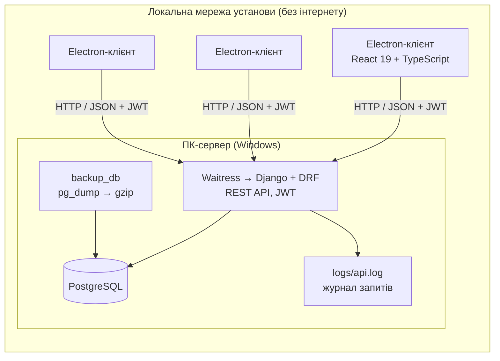
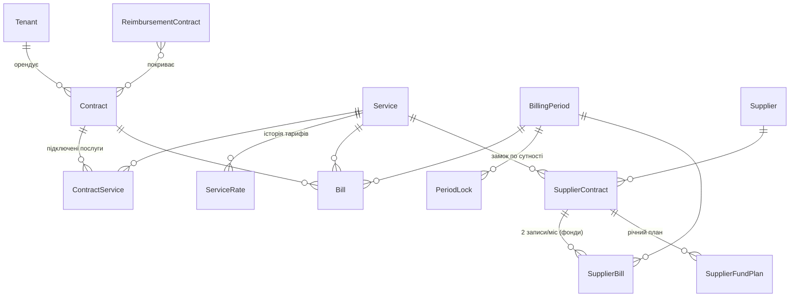

# Rent Manager

**Українська** · [English](README.en.md)

**Desktop-застосунок для обліку оренди приміщень і комунальних платежів у локальній мережі без інтернету.**


Комерційний проєкт, який я розробив самостійно для бюджетної установи — від збору вимог у бухгалтерії до розгортання на сервері клієнта та подальшої підтримки. Застосунок у щоденній роботі, розвивається ітераціями за запитами клієнта (версії 1.0 → 1.6.0).

<!-- Скріншоти: додати в docs/screenshots/ (на тестових даних, без реальних назв орендарів) -->

---

## Зміст

- [Яку задачу вирішує](#яку-задачу-вирішує)
- [Можливості](#можливості)
- [Архітектура](#архітектура)
- [Технічні рішення](#технічні-рішення)
- [Стек](#стек)
- [Швидкий старт](#швидкий-старт)
- [Тести](#тести)
- [Структура репозиторію](#структура-репозиторію)
- [Документація](#документація)
- [Ліцензія](#ліцензія)

---

## Яку задачу вирішує

Установа здає приміщення в оренду, а орендарі відшкодовують їй комунальні послуги (вода, тепло, електроенергія…). Щомісяця бухгалтерія має:

- зафіксувати споживання й нарахування по кожному орендарю та кожній послузі;
- врахувати тарифи, які змінюються протягом року;
- звести оплати й борги;
- порівняти, скільки установа сама заплатила постачальникам — окремо по двох бюджетних фондах;
- «закрити» місяць, щоб ніхто заднім числом не змінив звітні дані.

Rent Manager замінює це однією спільною таблицею, у якій кілька співробітників працюють одночасно з різних ПК, а система рахує підсумки, борги й план/факт.

**Обмеження середовища**, що визначили архітектуру: мережа установи **ізольована від інтернету**, робочі місця — Windows, адміністрування — мінімальне. Тому — desktop-клієнт на Electron, один ПК як сервер і жодних хмарних сервісів.

## Можливості

**Облік і розрахунки**

- Довідники: орендарі, договори оренди, послуги, постачальники та їхні договори
- Генерація місячних рахунків для всіх активних договорів однією кнопкою (або з CLI)
- Історія тарифів з датою початку дії; тариф фіксується в рахунку на момент створення
- Наростаючий борг у межах року, план/факт/залишок за річним планом
- Договори відшкодування: один документ покриває кілька договорів оренди → окремі секції з підсумками
- Облік постачальника з розбивкою на два бюджетні фонди і рядком «Різниця» (постачальник − орендарі)
- Масові операції: нарахування та оплата для групи рахунків

**Робочий процес і доступ**

- Три ролі — **менеджер** вводить дані, **бухгалтер** перевіряє та закриває періоди, **адміністратор** може все
- Закриття періоду окремо для орендарів і для постачальників
- Верифікація рахунків бухгалтером

**Інтерфейс**

- Велика таблиця «Рахунки»: згруповані заголовки (місяць → показник), закріплені колонки, зміна ширини, приховування місяців і типів колонок, прокрутка перетягуванням, пошук по словах
- Одночасна робота кількох користувачів: дані автоматично оновлюються кожні 30 с
- Експорт в Excel з тими самими формулами та підсумками, що й у таблиці
- Дашборд з метриками й графіками
- Діалог «Що нового» і сповіщення про вихід нової версії

## Архітектура



- **Сервер** — Django REST API під WSGI-сервером Waitress (працює на Windows, на відміну від Gunicorn). Автозапуск і щоденні бекапи — через Task Scheduler.
- **Клієнт** — React-SPA, упакована в Electron (`portable .exe` або NSIS-інсталятор). Адреса API «запікається» в збірку, тому є окремі режими: «все на одному ПК» і «мережа».
- **Django** віддає лише JSON — статику роздавати не треба, вона всередині `.exe`.

### Модель даних



`Bill` — місячне нарахування (споживання, тариф, нараховано, сплачено, корекція), унікальне для пари «договір + послуга» в періоді. Детальний опис полів і бізнес-правил — у [docs/DEVELOPMENT.md](docs/DEVELOPMENT.md#бізнес-правила-детально).

## Технічні рішення

Задачі, які виявились нетривіальними, і як я їх вирішив.

**Гроші без похибок округлення.** Усі суми — `DecimalField`, в API передаються рядками, а не числами. Округлення — лише half-up і в одному місці на кожному боці (`Decimal.quantize(ROUND_HALF_UP)` на бекенді, `roundMoney()` на фронті). Привід — реальний баг: `13.75 × 27.444` у float дає `377.35499…` і округлювалось до `377.35` замість `377.36`. Для вже збережених даних написана одноразова команда `recalc_accrued` з `--dry-run`.

**Історичність даних.** Тариф зберігається історією (`ServiceRate` з `effective_from`) і копіюється в рахунок як снапшот — зміна тарифу не переписує минулі місяці. Закриття періоду винесене в окрему модель `PeriodLock` (період + сутність), щоб орендарів і постачальників можна було закривати незалежно.

**Зворотна сумісність API.** Авто-оновлення в ізольованій мережі немає, тому старі клієнти живуть місяцями. Коли закриття періоду переїхало в `PeriodLock`, поле `is_closed` залишилось в API як обчислювана властивість — старі `.exe` продовжують працювати. Про нову версію клієнт дізнається з `GET /api/version/` і показує сповіщення.

**Одночасне редагування.** SWR (кеш запитів за URL) оновлює дані у фоні кожні 30 с. Після збереження комірки кеш оновлюється оптимістично, без повторного запиту — інакше велика таблиця мерехтіла б і скидала прокрутку.

**Одне джерело формул.** «Спожито», наростаючий борг і підсумки рахуються функціями в `lib/billing-utils.ts`, які використовують і таблиця, і Excel-експорт — цифри на екрані та у файлі гарантовано збігаються.

**Ролі.** Ролі — це Django Groups; при логіні роль кладеться в JWT, і фронт показує/ховає дії. Справжня перевірка прав — на сервері в кожному view.

**Безпека Electron.** `contextIsolation` + `sandbox`, заборона навігації та нових вікон, відмова на всі запити дозволів (камера, геолокація…), Content-Security-Policy, яку Vite-плагін генерує лише для prod-збірки з адресою API в `connect-src`. Секрети бекенду — тільки в `.env`, не в git.

**Розмір і швидкість клієнта.** Lazy-завантаження сторінок і динамічний імпорт бібліотеки Excel зменшили стартовий JS-бандл з 1505 до 477 КБ; налаштування electron-builder — portable `.exe` з 90,8 до 82,5 МБ.

**Експлуатація на Windows.** Журнал усіх API-запитів з ротацією (middleware, без паролів і токенів), щоденні бекапи PostgreSQL з повторами при збої, фізично розділені dev- і prod-середовища на одній машині. Коли система моніторингу безпеки клієнта (SOC) позначила запуск `powershell -ExecutionPolicy Bypass` як підозрілий (MITRE T1059.001), логіку скриптів перенесено в Django management command, а обгортки переписано на чистий `cmd`.

## Стек

| Шар            | Технології                                                                      |
| -------------- | ------------------------------------------------------------------------------- |
| Backend        | Python, Django 6, Django REST Framework, SimpleJWT, PostgreSQL (SQLite для dev) |
| Frontend       | React 19, TypeScript, Vite 7, React Router 7                                    |
| UI             | shadcn/ui (Radix UI), Tailwind CSS v4, TanStack Table, Recharts, Sonner         |
| Дані й форми   | SWR + Axios, react-hook-form + zod                                              |
| Desktop        | Electron, electron-builder (portable `.exe`, NSIS-інсталятор)                   |
| Інфраструктура | Waitress, Windows Task Scheduler, `pg_dump`, `.env`-конфігурація                |

## Швидкий старт

Потрібно: **Python 3.12+**, **Node.js 20+**. PostgreSQL необов'язковий — за замовчуванням використовується SQLite.

```powershell
# Backend
cd backend
pip install -r requirements.txt
copy .env.example .env            # робочі dev-дефолти (SQLite, DEBUG=True); у bash — cp
python manage.py migrate
python manage.py setup_groups     # групи ролей «Бухгалтер» / «Менеджер»
python manage.py createsuperuser

# Frontend
cd ../frontend
npm install
copy .env.development.example .env.development
npm run dev:all                   # Django (8001) + Vite (5173) + Electron
```

Без Electron, лише в браузері — `npm run dev:web` і відкрити `http://localhost:5173`. Ролі користувачам призначаються в Django Admin (`http://localhost:8001/admin/`).

Збірка `.exe`, розгортання в мережі та реліз — у [docs/DEVELOPMENT.md](docs/DEVELOPMENT.md).

## Тести

91 тест Django: генерація рахунків, замки періодів, постачальники й фонди, масові нарахування/оплати, договори відшкодування, бекап.

```powershell
cd backend
$env:DB_ENGINE = "django.db.backends.sqlite3"; python manage.py test rentals
# bash: DB_ENGINE=django.db.backends.sqlite3 python manage.py test rentals
```

## Структура репозиторію

```
rent_manager/
├── backend/
│   ├── config/                  # settings (.env), urls, wsgi
│   ├── rentals/
│   │   ├── models.py            # доменні моделі
│   │   ├── serializers.py
│   │   ├── views.py             # ViewSets + actions (close/reopen/verify/generate)
│   │   ├── auth_views.py        # JWT-логін з роллю в токені
│   │   ├── middleware.py        # журнал API-запитів
│   │   ├── services/            # бізнес-логіка: генерація рахунків, масові операції
│   │   ├── management/commands/ # CLI: генерація, бекап, групи ролей, перерахунок
│   │   └── test_*.py, tests.py
│   ├── serve.py                 # production-запуск через Waitress
│   └── *.bat                    # запуск сервера й бекапів на Windows
├── frontend/
│   └── src/
│       ├── electron/main.js     # головний процес Electron
│       ├── pages/               # CRUD-сторінки, дашборд
│       ├── components/          # таблиця «Рахунки», форми, діалоги, ui/ (shadcn)
│       ├── hooks/               # SWR-хуки
│       ├── lib/                 # billing-utils (формули), export-xlsx, api-client
│       ├── context/             # авторизація та ролі
│       └── types/               # типи API
└── docs/                        # посібник розробника, розгортання, плани фіч
```

## Документація

| Документ                                                                         | Про що                                                                                 |
| -------------------------------------------------------------------------------- | -------------------------------------------------------------------------------------- |
| [docs/DEVELOPMENT.md](docs/DEVELOPMENT.md)                                       | налаштування машини, збірка `.exe`, реліз, повний перелік API й команд, бізнес-правила |
| [docs/DEPLOY.md](docs/DEPLOY.md)                                                 | розгортання на окремому ПК-сервері, чек-лист безпеки `.env`                            |
| [backend/AUTOSTART.md](backend/AUTOSTART.md)                                     | автозапуск сервера, розклад бекапів, відновлення з бекапу                              |

## Ліцензія

© 2026 Махно Андрій Андрійович. Програма пропрієтарна; код опубліковано для ознайомлення. Умови використання — у [LICENSE.txt](LICENSE.txt). Сторонні open-source компоненти поширюються за власними ліцензіями.
